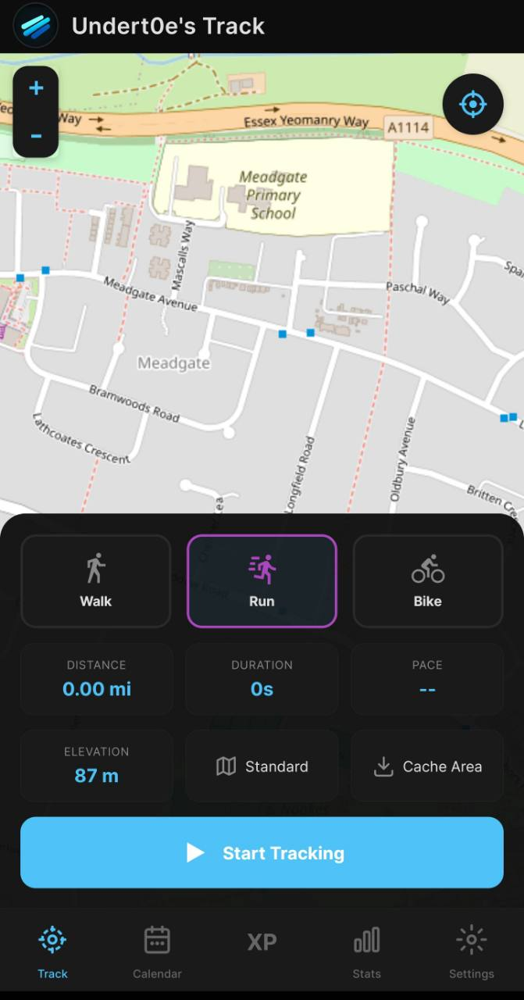
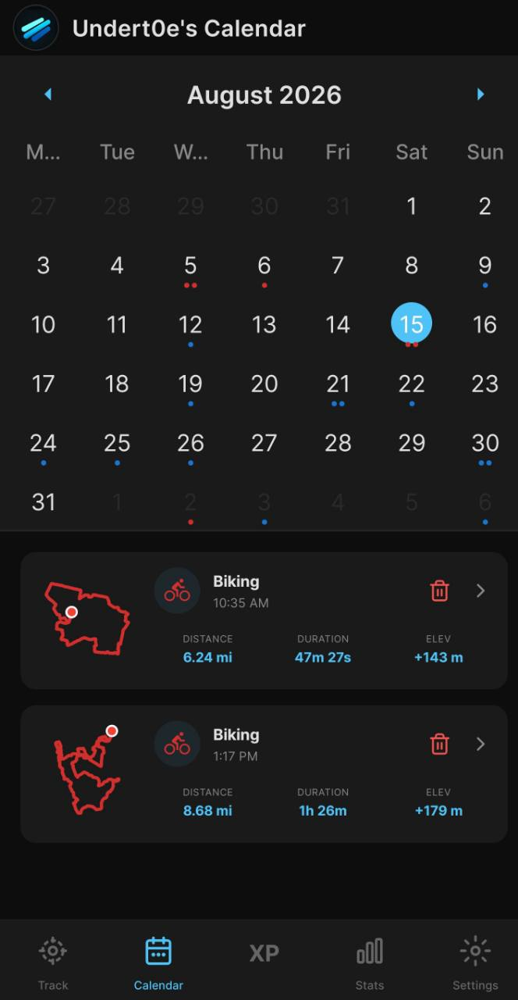
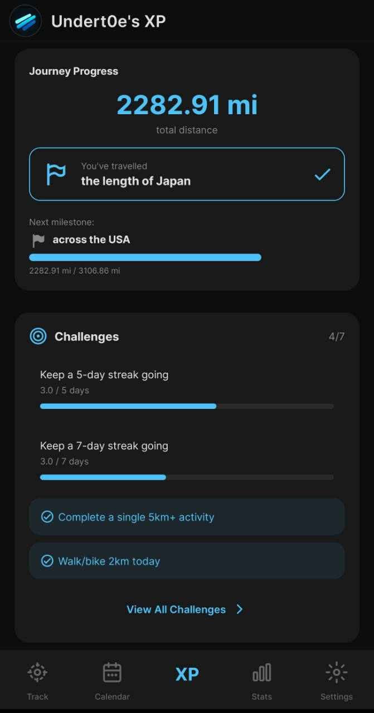
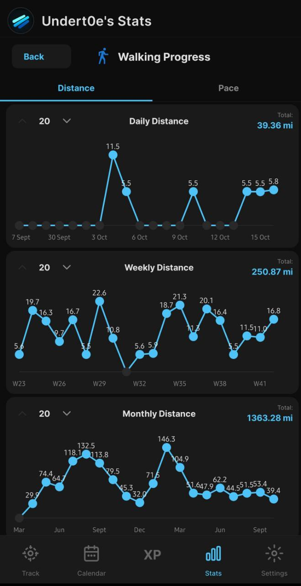
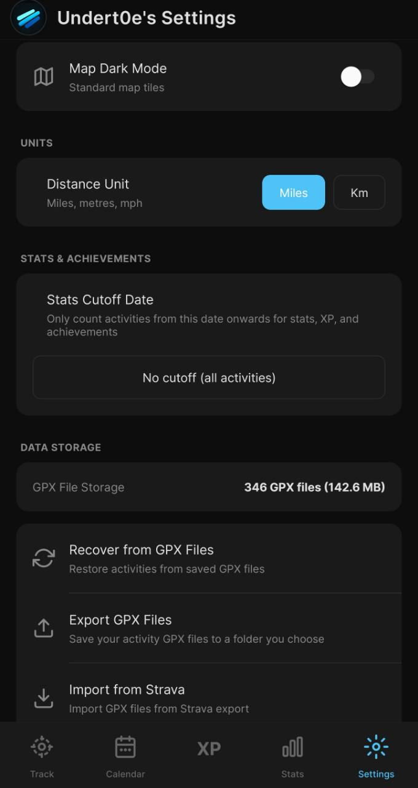

# TrailTrackerXP

**Track every walk, run and ride. Keep your GPX history. Build momentum without a subscription.**

TrailTrackerXP is a focused, subscription-free Strava alternative for Android walkers, runners and cyclists.
Record routes, review stats, import an existing Strava archive, and turn consistency into XP,
achievements and challenges—all while keeping activity files on your device.

[](https://github.com/Undert0e-505/TrailTrackerXP/releases/latest)
[](https://github.com/Undert0e-505/TrailTrackerXP/releases/latest)
[](https://expo.dev/)

[Download the latest release](https://github.com/Undert0e-505/TrailTrackerXP/releases/latest) ·
[Development guide](docs/DEVELOPMENT.md) · [Build guide](docs/BUILD_AND_RELEASE.md)

## Your activity, at a glance

| Run tracking | Calendar and route history | Journey and challenges |
| :---: | :---: | :---: |
| [](docs/images/tracking-run.jpg) | [](docs/images/calendar-history.jpg) | [](docs/images/xp-journey-challenges.jpg) |

## Record the route, not just the result

Choose walking, running or biking, then follow the live route map while TrailTrackerXP measures distance,
duration, elevation and pace. Pause and resume when needed, preview the route at the end, and save
the activity as a GPX file. A foreground service keeps an active recording running in the
background when Android grants the required location permissions.

Map styles include OpenStreetMap, OpenTopoMap and CyclOSM. TrailTrackerXP can cache supported map
tiles and provides controls to inspect or clear that cache; tile availability still depends on the
external providers and what has already been cached.

## Make consistency rewarding

Every saved activity contributes to a visible sense of progress rather than disappearing into a
feed. Earn XP and levels, build weekly streaks, unlock bronze, silver and gold achievements, and
work toward daily or weekly challenges. Automatic challenges provide a ready-made target, while
selectable challenges let you choose the goal that suits you now.

Selected challenge progress begins when you accept the challenge, so earlier activities do not
retroactively complete it. The [challenge system guide](docs/CHALLENGES.md) explains the full rules.

## Keep and understand your history

Your saved activities live on the device as GPX files, supported by a local app cache. Browse them
on a calendar, open activity details, and replay a route. Compare walking, running and cycling over daily,
weekly, monthly and all-time views, with distance plus pace-or-speed charts that make longer-term
changes easy to see.

GPX export, import and recovery tools keep the underlying activity files within reach. If you are
moving away from Strava, request your archive there and import its GPX activities into
TrailTrackerXP rather than starting over.

| Walking progress | Local data control |
| :---: | :---: |
| [](docs/images/walking-stats.jpg) | [](docs/images/settings-gpx-import.jpg) |

Choose miles or kilometres, set a stats cutoff date, and manage local GPX files and the map cache
from one place.

## Get started

1. Download the signed APK from the [latest release](https://github.com/Undert0e-505/TrailTrackerXP/releases/latest).
2. Install it on an Android device and grant location access. Allow background location if you
   want an activity to continue recording while TrailTrackerXP is not in the foreground.
3. Choose **Walk**, **Run** or **Bike**, start tracking, and save the route when you finish.
4. Explore the calendar, stats and XP screens—or import GPX activities from a Strava archive in
   Settings.

## Privacy and limitations

- TrailTrackerXP is Android-only. It has no subscription or billing system; activity history and
  app state are stored locally on the device.
- Background recording requires location and background-location permission. Android device power
  management can also affect foreground-service and location behavior.
- Live maps and route detail views rely on external map tiles and Leaflet assets. Network access is
  required when the needed resources are not already available in the cache, and cache coverage
  varies by map style and area.
- GPS accuracy, elevation readings and battery use depend on the device, signal conditions,
  surroundings and recording duration.
- Local storage means backup is your responsibility. Export or copy important GPX files before
  replacing, resetting or uninstalling the app.
- TrailTrackerXP is not affiliated with, endorsed by or sponsored by Strava. Strava is a trademark
  of its respective owner.

## Documentation

- [Development guide](docs/DEVELOPMENT.md) — setup, project structure, data storage and Strava import
- [Build and release guide](docs/BUILD_AND_RELEASE.md) — local builds, APK creation and signing
- [Challenge system](docs/CHALLENGES.md) — challenge architecture, selection and completion rules
- [Documentation index](docs/DOCS_INDEX.md) — all project documentation

## Build and development

TrailTrackerXP uses React Native with Expo SDK 51. Install Node.js/npm, JDK 21 and an Android SDK,
then use the local Windows build script from the repository root:

```powershell
# Dev/debug APK for Metro development
.\scripts\build-and-release.ps1 -DebugBuild

# Release-signed, install-over candidate for physical-phone QA
.\scripts\build-signed-local.ps1 -ReferenceApk C:\path\to\published.apk

# Promote the exact candidate bytes after physical-device acceptance (no rebuild)
.\scripts\build-and-release.ps1 -PromoteCandidate <tested-candidate.apk>
```

Builds generate the uncommitted native Android project with Expo prebuild and place uniquely named
APKs in the ignored `releases/` directory. Signed candidates are verified for package, version,
signature and pinned release certificate before handoff; promotion copies the tested bytes without
rebuilding. GitHub publication remains a separate, explicitly authorized maintainer action. See the
[build guide](docs/BUILD_AND_RELEASE.md) for setup and the [signing guide](docs/SIGNING.md) for key
safety.

The current app release is **v2.0.0**. Browse all builds on the
[releases page](https://github.com/Undert0e-505/TrailTrackerXP/releases).

## Rights

Private project. All rights reserved.
